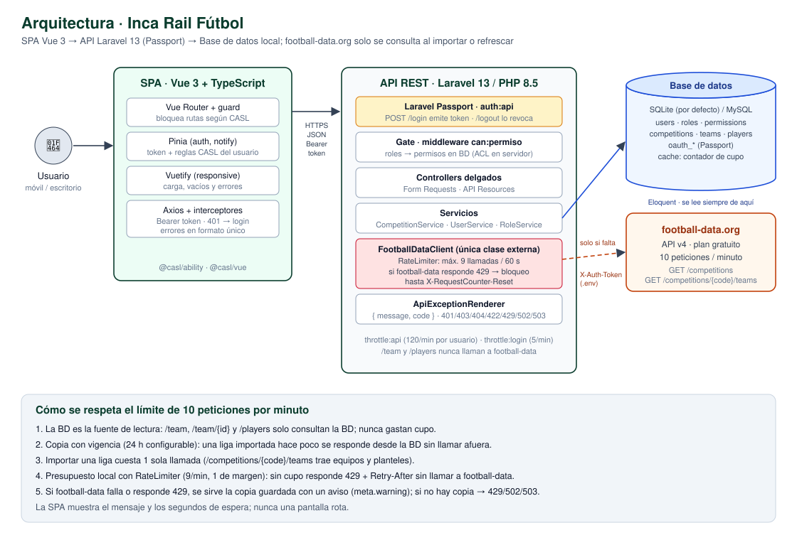
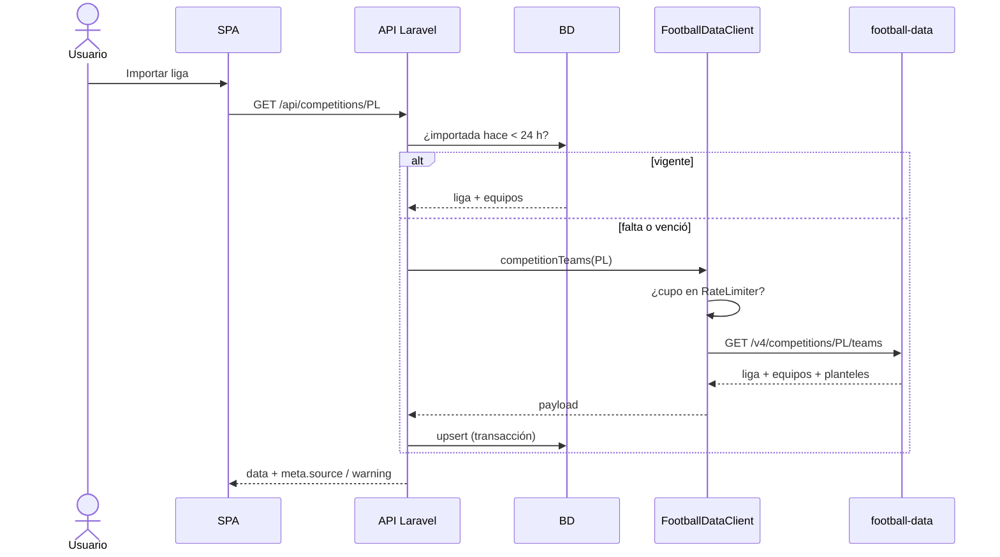
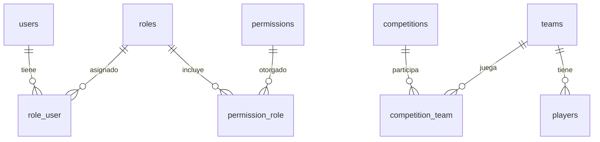

# Inca Rail · Plataforma de fútbol (Prueba técnica Senior Full Stack)

API REST en **Laravel 13 / PHP 8.5** con **Passport** y una SPA en **Vue 3 + TypeScript** para consultar ligas, equipos y jugadores de [football-data.org](https://www.football-data.org), guardando una copia propia de lo consultado y controlando qué puede hacer cada rol.

```
.
├── backend/        API Laravel 13
├── frontend/       SPA Vue 3 (Vite, Vuetify, Pinia, CASL)
├── docs/           Diagramas (SVG/PNG + fuentes Mermaid)
└── .github/        CI (pruebas, estilo y build)
```

## Índice

1. [Requisitos](#1-requisitos)
2. [Cómo ejecutarlo](#2-cómo-ejecutarlo)
3. [Usuarios de prueba](#3-usuarios-de-prueba)
4. [Endpoints](#4-endpoints)
5. [Límite de 10 peticiones por minuto](#5-límite-de-10-peticiones-por-minuto)
6. [Decisiones de arquitectura](#6-decisiones-de-arquitectura)
7. [Diagramas](#7-diagramas)
8. [Pruebas](#8-pruebas)
9. [Supuestos](#9-supuestos)
10. [Pendiente y cómo lo haría](#10-pendiente-y-cómo-lo-haría)

---

## 1. Requisitos

| Herramienta | Versión |
|---|---|
| PHP | 8.5 (extensiones `pdo_sqlite`, `sqlite3`, `mbstring`, `openssl`) |
| Composer | 2.x |
| Node.js | 22.18+ o 24.12+ |
| Token de football-data.org | Gratuito: https://www.football-data.org/client/register |

La base de datos por defecto es **SQLite** (no hay que instalar nada). Para usar MySQL basta con cambiar las variables `DB_*` del `.env`; todo está hecho con migraciones y Eloquent.

## 2. Cómo ejecutarlo

### Backend (http://localhost:8000)

```bash
cd backend
composer install
cp .env.example .env
php artisan key:generate
```

Edita `backend/.env` y coloca tu token:

```dotenv
FOOTBALL_DATA_TOKEN=tu_token_aqui
```

```bash
touch database/database.sqlite                  # Windows: type nul > database\database.sqlite
php artisan migrate --seed                       # tablas + roles, permisos y usuarios de prueba
php artisan passport:keys                        # llaves de cifrado de Passport
php artisan passport:client --personal --no-interaction
php artisan serve
```

### Frontend (http://localhost:5173)

```bash
cd frontend
npm install
cp .env.example .env.local
npm run dev
```

### Variables de entorno

| Variable | Dónde | Descripción |
|---|---|---|
| `FOOTBALL_DATA_TOKEN` | backend | Token de football-data. **Nunca se sube al repositorio.** |
| `FOOTBALL_DATA_BASE_URL` | backend | `https://api.football-data.org/v4` |
| `FOOTBALL_DATA_MAX_PER_MINUTE` | backend | Cupo local por minuto (por defecto 9, uno de margen sobre 10). |
| `FOOTBALL_DATA_CACHE_MINUTES` | backend | Vigencia de la copia local (por defecto 1440 = 24 h). |
| `VITE_API_URL` | frontend | URL del API, por defecto `http://localhost:8000/api`. |

## 3. Usuarios de prueba

Contraseña de todos: **`password`**

| Correo | Rol | Puede |
|---|---|---|
| admin@incarail.test | Administrador | Todo: ver, importar ligas, gestionar usuarios, roles y permisos. |
| operador@incarail.test | Operador | Ver competiciones, equipos y jugadores, e importar ligas. |
| consulta@incarail.test | Solo consulta | Ver competiciones, equipos y jugadores guardados. |

## 4. Endpoints

Todas las rutas usan el prefijo `/api` de Laravel. Todas, salvo `/login`, requieren `Authorization: Bearer <token>`.

| Método | Ruta | Permiso | Descripción |
|---|---|---|---|
| POST | `/api/login` | público (5/min) | Devuelve `access_token`, usuario y reglas CASL. |
| POST | `/api/logout` | autenticado | Revoca el token actual. |
| GET | `/api/me` | autenticado | Usuario + reglas CASL (`[{ action, subject }]`). |
| GET | `/api/competitions` | `competitions.read` | Todas las ligas (BD; se refresca de football-data cada 24 h). |
| GET | `/api/competitions/{competition_id}` | `competitions.import` | Detalle de una liga por id o código (`2021` o `PL`). Guarda sus equipos y jugadores. |
| GET | `/api/team` | `teams.read` | Equipos guardados. Filtros: `search`, `competition_id`, `page`, `per_page`. |
| GET | `/api/team/{team_id}` | `teams.read` | Detalle del equipo con plantel y ligas. |
| GET | `/api/players` | `players.read` | Jugadores guardados. Filtros: `search`, `position`, `team_id`, `page`, `per_page`. |
| GET/POST/PUT | `/api/users` | `users.manage` | Listar, crear, editar, asignar roles y activar/desactivar. |
| GET | `/api/roles` | `roles.manage` o `users.manage` | Roles con sus permisos. |
| POST/PUT/DELETE | `/api/roles` | `roles.manage` | Crear, editar (asignar permisos) y eliminar roles. |
| GET | `/api/permissions` | `roles.manage` | Catálogo de permisos. |

### Formato de errores

Siempre el mismo JSON:

```json
{ "message": "El equipo solicitado no existe.", "code": "NOT_FOUND" }
```

| HTTP | `code` | Cuándo |
|---|---|---|
| 401 | `UNAUTHENTICATED` | Sin token, token vencido o revocado. |
| 403 | `FORBIDDEN` | El rol no tiene el permiso. |
| 403 | `UPSTREAM_RESTRICTED` | La liga no está en el plan gratuito de football-data. |
| 404 | `NOT_FOUND` / `UPSTREAM_NOT_FOUND` | Equipo, jugador o liga inexistente. |
| 422 | `VALIDATION_ERROR` | Datos inválidos (incluye `errors` por campo). |
| 429 | `UPSTREAM_RATE_LIMIT` / `TOO_MANY_REQUESTS` | Sin cupo en football-data o en nuestro API (incluye `retry_after` y la cabecera `Retry-After`). |
| 502 | `UPSTREAM_ERROR` | football-data respondió con error. |
| 503 | `UPSTREAM_UNAVAILABLE` | Sin conexión con football-data (o falta el token). |

## 5. Límite de 10 peticiones por minuto

La idea central: **football-data es una fuente para importar, no para leer.** Las lecturas salen de nuestra BD y el cupo externo solo se gasta cuando hace falta.

1. **La BD es la fuente de lectura.** `/team`, `/team/{id}` y `/players` solo consultan la BD; nunca llaman a football-data, así que funcionan aunque el servicio externo esté caído o sin cupo.
2. **Copia con vigencia.** Una liga importada hace menos de `FOOTBALL_DATA_CACHE_MINUTES` (24 h) se responde desde la BD. La lista de ligas se refresca como máximo una vez por ese periodo.
3. **Una llamada por importación.** `GET /v4/competitions/{code}/teams` trae la liga, sus equipos y planteles en una sola petición, en vez de 1 + N llamadas por equipo.
4. **Presupuesto local antes de salir.** `FootballDataClient` usa el `RateLimiter` de Laravel (contador en el cache de la BD, compartido entre procesos) con 9 llamadas por minuto. Si no queda cupo, responde **429 con `retry_after`** sin llamar a football-data.
5. **Respeta el corte externo.** Si aun así football-data responde 429, se bloquean las llamadas hasta el tiempo que indica `X-RequestCounter-Reset`.
6. **Degradación controlada.** Si football-data falla o no hay cupo pero ya tengo la liga guardada, se devuelven los datos guardados con `meta.warning`; la SPA lo muestra como aviso. Solo si no hay copia se responde 429/502/503.
7. **Importar no duplica.** Los `id` de las tablas son los de football-data y se guarda con `upsert`, dentro de una transacción.

**Por qué no una cola:** con una sola llamada por liga y la copia local, una cola agregaba un worker más que levantar y una UX asíncrona (polling) sin necesidad real para este volumen. Queda como siguiente paso (ver pendientes).

**Cómo lo probé:** en `.env` puse `FOOTBALL_DATA_MAX_PER_MINUTE=2` y `FOOTBALL_DATA_CACHE_MINUTES=0`, e importé tres ligas seguidas: la tercera responde 429 con los segundos de espera y la SPA muestra el mensaje; equipos y jugadores siguen respondiendo normal. Esto también está cubierto por pruebas automáticas.

## 6. Decisiones de arquitectura

Comparé tres opciones:

| Opción | A favor | En contra para este proyecto |
|---|---|---|
| Hexagonal (puertos y adaptadores) | Dominio aislado de Laravel y de football-data. | Duplica modelos (entidades + Eloquent) y mappers para un CRUD con una sola integración. |
| Clean Architecture | Casos de uso explícitos y testeables. | Mismas capas extra; en 48 h, más estructura que lógica. |
| **Capas de Laravel + servicios (elegida)** | Simple, idiomática, fácil de leer y revisar. | Menos aislamiento si el dominio crece. |

Elegí **capas simples de Laravel con servicios**, tomando de hexagonal solo lo que aquí aporta: la integración externa está detrás de una sola clase (`FootballDataClient`), así que cambiar de proveedor o simularlo en pruebas no toca controladores ni servicios.

- **Controllers** delgados: validan con Form Requests, delegan y responden con API Resources.
- **Services** (`CompetitionService`, `UserService`, `RoleService`, `AuthService`): reglas de negocio y transacciones.
- **FootballDataClient**: única clase que habla con football-data; maneja token, cupo y errores HTTP.
- **ApiExceptionRenderer**: un solo lugar que convierte excepciones en el JSON de error.
- **ACL**: tablas `roles`, `permissions` y pivotes; `Gate::before` resuelve cualquier permiso por nombre, por lo que las rutas solo declaran `can:teams.read`. Cada permiso tiene `action` y `subject`, que el API entrega tal cual para CASL.

En el frontend: Composition API + TypeScript, Pinia para la sesión, Vuetify para el diseño responsive y CASL para ocultar rutas, menús y botones según lo que entrega `/api/me`. El servidor siempre valida igual: CASL es solo para la experiencia.

## 7. Diagramas

### Arquitectura — `docs/arquitectura.svg`



Muestra la SPA, el API con sus capas (Passport → Gate → controllers → servicios → `FootballDataClient`), la base de datos y football-data.org. Abajo resume cómo se respeta el límite de peticiones. Fuente editable: [`docs/arquitectura.mmd`](docs/arquitectura.mmd).

### Importación de una liga — `docs/flujo-importacion.mmd`

Diagrama de secuencia de `GET /api/competitions/{id}`: cuándo se responde desde la BD, cuándo se llama a football-data y qué pasa si no hay cupo o el servicio falla. GitHub lo renderiza directamente:



### Modelo de datos — `docs/modelo-datos.mmd`

Tablas y relaciones: usuarios ↔ roles ↔ permisos (muchos a muchos), ligas ↔ equipos (muchos a muchos) y equipo → jugadores. Los ids de ligas, equipos y jugadores son los de football-data, lo que evita duplicados.



## 8. Pruebas

```bash
cd backend
php artisan test
```

- **Unitarias** (`tests/Unit/FootballDataClientTest.php`): token en cabecera, corte por cupo local, bloqueo tras un 429 externo, error de conexión.
- **Integración** (`tests/Feature`): 401/403/404/422 con el formato de error, permisos por rol, importar dos veces sin duplicar, servir datos guardados con football-data caído, 429 con `Retry-After`, y que `/team` y `/players` no llamen afuera.

Las llamadas externas se simulan con `Http::fake()`, así que las pruebas no necesitan token. La CI (`.github/workflows/ci.yml`) corre estilo (Pint), pruebas y el build del frontend en cada push.

## 9. Supuestos

- **Rutas con prefijo `/api`:** mantuve las rutas tal como están en el enunciado (`/competitions`, `/team`, `/players`) bajo el prefijo estándar de Laravel.
- **Importar requiere permiso:** como `GET /competitions/{id}` escribe en la BD, lo protegí con `competitions.import`. El rol de solo consulta ve ligas, equipos y jugadores ya guardados.
- **`{competition_id}`** acepta el id numérico o el código (`2021` o `PL`), igual que football-data.
- **Número de camiseta:** se guarda `shirtNumber` cuando el plantel lo trae; en el plan gratuito puede venir vacío, por eso la columna es nullable. Pedirlo jugador por jugador rompería el límite de peticiones.
- **Permisos fijos, roles editables:** los permisos los define el sistema (seeder) porque cada uno corresponde a una regla en el código; desde la SPA se crean roles y se les asignan permisos. El rol `admin` siempre conserva todos los permisos y no se puede eliminar.
- **Desactivar = no borrar:** un usuario desactivado no puede iniciar sesión y sus tokens se revocan al instante.
- **Sesión de 8 horas:** el token de Passport vence a las 8 h; al vencer, la SPA lleva al login con un aviso.

## 10. Pendiente y cómo lo haría

- **Docker (compose.yml):** Nginx + PHP-FPM 8.5 + MySQL + Node para el build del frontend.
- **Colas y refresco programado:** un `ImportCompetitionJob` con `RateLimited` middleware de jobs y un comando en el scheduler que refresque las ligas importadas de noche.
- **Eventos:** emitir `CompetitionImported` para auditoría o notificaciones.
- **Pruebas de aceptación:** flujo login → importar liga → ver equipo con Playwright.
